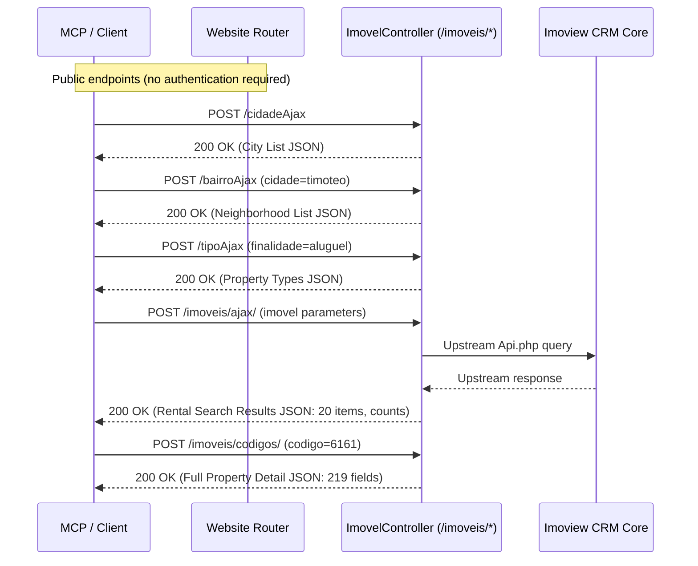

# Reverse-Engineered Rental Search API Documentation
**Target Domain**: `minascaixaimoveis.com.br`  
**Focus**: Rental Search, Supporting Metadata (Filters), Pagination, and Property Detail Retrieval  
**Status**: Completely reverse-engineered, validated, and reproducible without authentication.

---

## 1. System Overview & Architecture

Minas Caixa Imóveis operates a PHP/Apache web application integrated with the Imoview real estate CRM. 



### Key Architectural Findings:
1. **Client-Side Rendering via AJAX**: The frontend search landing pages (such as `/aluguel/imoveis/timoteo/...`) render an empty container `<div class="corpo-imoveis"></div>`. The entire listing dataset is fetched asynchronously via an internal AJAX endpoint (`/imoveis/ajax/`) and rendered in the browser.
2. **Authentication Status**: **None**. All search, filter, pagination, and detail endpoints are unauthenticated and publicly accessible without cookies, CSRF tokens, or bearer headers.
3. **Upstream Dependency**: The PHP backend calls `Api.php` (Imoview CRM). If required form fields are omitted in the search payload, `Api.php` fails with HTTP 500.

---

## 2. Target URL Deconstruction

**Target URL**:
```text
https://www.minascaixaimoveis.com.br/aluguel/imoveis/timoteo/todos-os-bairros/0-quartos/0-suite-ou-mais/0-vaga/0-banheiro-ou-mais/todos-os-condominios?valorminimo=0&valormaximo=0&pagina=1
```

### Path Segments & Query Mapping
| Segment Index | Path Component | Value in Target URL | API Parameter Mapped |
|---|---|---|---|
| Segment 1 | Purpose (`finalidade`) | `aluguel` | `imovel[finalidade] = "aluguel"` |
| Segment 2 | Types (`tipo`) | `imoveis` (all types) | Omitted or all types |
| Segment 3 | City (`cidade`) | `timoteo` | `imovel[codigocidade] = "timoteo"` |
| Segment 4 | Neighborhood (`bairro`) | `todos-os-bairros` | Omitted or all bairros |
| Segment 5 | Bedrooms (`quartos`) | `0-quartos` | `imovel[numeroquartos] = "0-quartos"` |
| Segment 6 | Suites (`suite`) | `0-suite-ou-mais` | `imovel[numerosuite] = "0-suite-ou-mais"` |
| Segment 7 | Parking (`vagas`) | `0-vaga` | `imovel[numerovagas] = "0-vaga"` |
| Segment 8 | Bathrooms (`banheiro`) | `0-banheiro-ou-mais` | `imovel[numerobanhos] = "0-banheiro-ou-mais"` |
| Segment 9 | Condo (`condominio`) | `todos-os-condominios` | `imovel[codigocondominio] = "0"` |
| Query `valorminimo` | Minimum Price | `0` | `imovel[valorde] = "0"` |
| Query `valormaximo` | Maximum Price | `0` | `imovel[valorate] = "0"` |
| Query `pagina` | Current Page | `1` | `imovel[pagina] = "1"` |

---

## 3. Detailed Endpoint Catalog

### 3.1. Supporting Filter Endpoints

#### `POST /cidadeAjax`
Retrieves all available cities.
- **URL**: `https://www.minascaixaimoveis.com.br/cidadeAjax`
- **Method**: `POST`
- **Payload**: None required (empty body)
- **Response**: Array of city items
```json
[
  {
    "nome": "timoteo",
    "codigo": 1,
    "nomeOriginal": "Timóteo"
  },
  {
    "nome": "coronel-fabriciano",
    "codigo": 2,
    "nomeOriginal": "Coronel Fabriciano"
  },
  {
    "nome": "ipatinga",
    "codigo": 3,
    "nomeOriginal": "Ipatinga"
  }
]
```

#### `POST /bairroAjax`
Retrieves neighborhoods filtered by city.
- **URL**: `https://www.minascaixaimoveis.com.br/bairroAjax`
- **Method**: `POST`
- **Payload**: Form data with `cidade` (city slug or name, e.g. `cidade=timoteo`)
- **Response**: Array of neighborhood items
```json
[
  {
    "nome": "alegre",
    "nome_cidade": "timoteo",
    "codigo": 45,
    "nomeOriginal": "Alegre",
    "nomeCidadeOriginal": "Timoteo"
  },
  {
    "nome": "centro",
    "nome_cidade": "timoteo",
    "codigo": 1,
    "nomeOriginal": "Centro",
    "nomeCidadeOriginal": "Timoteo"
  },
  {
    "nome": "funcionarios",
    "nome_cidade": "timoteo",
    "codigo": 20,
    "nomeOriginal": "Funcionarios",
    "nomeCidadeOriginal": "Timoteo"
  }
]
```

#### `POST /tipoAjax`
Retrieves available property types for the given transaction purpose.
- **URL**: `https://www.minascaixaimoveis.com.br/tipoAjax`
- **Method**: `POST`
- **Payload**: Form data with `finalidade` (`aluguel` or `venda`)
- **Response**: Array of property type items
```json
[
  { "nome": "apartamento", "codigo": 2, "nomeOriginal": "Apartamento" },
  { "nome": "casa", "codigo": 1, "nomeOriginal": "Casa" },
  { "nome": "galpao", "codigo": 11, "nomeOriginal": "Galpão" },
  { "nome": "loja", "codigo": 5, "nomeOriginal": "Loja" },
  { "nome": "predio", "codigo": 8, "nomeOriginal": "Prédio" },
  { "nome": "sala", "codigo": 6, "nomeOriginal": "Sala" },
  { "nome": "sitio", "codigo": 15, "nomeOriginal": "Sítio" }
]
```

#### `POST /condominios`
Retrieves available condominiums for the transaction purpose.
- **URL**: `https://www.minascaixaimoveis.com.br/condominios`
- **Method**: `POST`
- **Payload**: Form data with `finalidade` (`aluguel` or `venda`)
- **Response**: Array of condominium items (empty `[]` when no condos have active rental units).

---

### 3.2. Rental Search & Listing Endpoint

#### `POST /imoveis/ajax/`
Executes rental searches matching filter criteria with pagination.
- **URL**: `https://www.minascaixaimoveis.com.br/imoveis/ajax/`
- **Method**: `POST`
- **Content-Type**: `application/x-www-form-urlencoded`

#### Request Parameters:
| Parameter Key | Mandatory? | Type | Allowed Values / Format | Description |
|---|---|---|---|---|
| `imovel[finalidade]` | **YES** | string | `"aluguel"`, `"venda"` | Transaction purpose (always `"aluguel"` for rentals) |
| `imovel[valorde]` | **YES** | string/int | `"0"`, numeric string | Minimum price threshold |
| `imovel[valorate]` | **YES** | string/int | `"0"`, numeric string | Maximum price threshold (`"0"` means no upper limit) |
| `imovel[pagina]` | **YES** | string/int | `"1"`, `"2"`, ... | Page number (1-indexed) |
| `imovel[codigocondominio]` | **YES** | string/int | `"0"`, condo ID | Condominium identifier (`"0"` for all) |
| `imovel[codigocidade]` | NO | string/int | `"timoteo"`, or city ID | City slug or numeric ID |
| `imovel[numeroquartos]` | NO | string | `"0-quartos"`, `"1-quartos"`, `"2-quartos"`, `"3-quartos"`, `"4-quartos"` | Minimum number of bedrooms |
| `imovel[numerovagas]` | NO | string | `"0-vaga"`, `"1-vaga"`, `"2-vaga"`, `"3-vaga"`, `"4-vaga"` | Minimum number of parking spots |
| `imovel[numerosuite]` | NO | string | `"0-suite-ou-mais"`, `"1-suites"`, `"2-suites"`, `"3-suites"`, `"4-suites"` | Minimum number of suites |
| `imovel[numerobanhos]` | NO | string | `"0-banheiro-ou-mais"`, `"1-banheiro"`, `"2-banheiro"`, `"3-banheiro"` | Minimum number of bathrooms |
| `imovel[ordenacao]` | NO | string | `"valordesc"` (highest price), `"valorasc"` (lowest price), `""` (default) | Sorting preference |
| `imovel[codigoTipo][codigo][]` | NO | string/list | Array of numeric IDs (e.g. `"2"`, `"1"`) | Selected property type IDs |
| `imovel[codigoTipo][nome][]` | NO | string/list | Array of slugs (e.g. `"apartamento"`, `"casa"`) | Selected property type slugs |
| `imovel[codigosbairros][codigo][]`| NO | string/list | Array of numeric IDs (e.g. `"1"`, `"20"`) | Selected neighborhood IDs |
| `imovel[codigosbairros][nome][]` | NO | string/list | Array of slugs (e.g. `"centro"`, `"funcionarios"`) | Selected neighborhood slugs |

> [!CAUTION]
> The five parameters marked as **YES** above are strictly mandatory. Omitting any of them triggers an internal PHP `Api.php` failure (HTTP 500 / fatal error).

#### Response Schema:
```json
{
  "quantidade": 29,
  "menorvalor": "R$ 500,00",
  "maiorvalor": "R$ 20.000,00",
  "menorarea": "30,00",
  "maiorarea": "1001,63",
  "lista": [
    {
      "codigo": 6161,
      "codigocondominio": 0,
      "nomecondominio": "",
      "nomeempreendimento": "",
      "titulo": "predio-comercial-imperdivel-nos-funcionarios-com-10-salas-em-timoteo",
      "codigoauxiliar": "",
      "finalidade": "Aluguel",
      "codigotipo": 8,
      "tipo": "Prédio",
      "codigotipo2": null,
      "tipo2": "",
      "valor": "R$ 20.000,00",
      "valorminimo": "R$ 20.000,00",
      "valormaximo": "R$ 20.000,00",
      "valoranterior": "R$ 0,00",
      "valorcondominio": "R$ 0,00",
      "codigobairro": 20,
      "bairro": "Funcionarios",
      "codigobairro2": null,
      "bairro2": "",
      "codigocidade": 1,
      "cidade": "Timóteo",
      "estado": "MG",
      "regiao": "Setor 1",
      "endereco": "Avenida Cyro Cotta Poggiali",
      "numero": "**",
      "complemento": "*****",
      "aceitapermuta": false,
      "exclusivo": false,
      "numeroquartos": "0",
      "numerosalas": "10",
      "numerobanhos": "4",
      "numerovagas": "3",
      "tipovagas": "Linha.",
      "numerosuites": "0",
      "areaprincipal": "1001,63",
      "areainterna": "694,00",
      "areaexterna": "1001,63",
      "arealote": "0,00",
      "tipomedida": "m²",
      "urlfotoprincipalp": "https://cdn.imoview.com.br/minascaixa/Imoveis/6161/p7suak-....jpg",
      "descricaoFotoPrincipal": "Prédio para aluguel no Funcionarios: ",
      "urlpublica": "",
      "datahoracadastro": "27/06/2025 11:07:27",
      "fotos": [
        {
          "descricao": "Prédio para aluguel no Funcionarios: ",
          "urlp": "https://cdn.imoview.com.br/minascaixa/Imoveis/6161/p7suak-....jpg"
        }
      ]
    }
  ]
}
```

---

### 3.3. Property Detail Endpoints

#### `POST /imoveis/codigos/` (Direct Structured Detail API)
Retrieves the complete property detail record for one or more property codes.
- **URL**: `https://www.minascaixaimoveis.com.br/imoveis/codigos/`
- **Method**: `POST`
- **Payload**:
  - `codigo`: string with single ID or comma-delimited IDs (e.g. `codigo=6161` or `codigo=6161,7989`)
  - `finalidade`: optional (e.g. `finalidade=aluguel`)
- **Batching Support**: **Yes**. Multiple properties can be retrieved in a single request by joining codes with commas.
- **Response**: Full object containing **219 property attributes** per item in `lista`.

#### Comprehensive Field Grouping (219 attributes):
- **Core Identifiers**: `codigo`, `codigoauxiliar`, `codigomae`, `titulo`, `metadescription`, `situacao`, `destaque`.
- **Financial Breakdown**: `valor`, `valorminimo`, `valormaximo`, `valoranterior`, `valorcondominio`, `valoriptu`, `valoriptuanual`, `valorm2`, `valormaiscondominio`, `valormaiscondominiomaisiptu`, `valorseguroincendio`, `valorparcelaseguroincendio`, `taxaadm`, `taxacomissao`, `taxaintermediacao`.
- **Location & Geocoding**: `cidade`, `codigocidade`, `bairro`, `codigobairro`, `estado`, `regiao`, `subregiao`, `endereco`, `numero`, `complemento`, `cep`, `latitude`, `longitude`, `pontoreferencia`, `melhoracesso`.
- **Physical Dimensions**: `areaprincipal`, `areainterna`, `areaexterna`, `arealote`, `areapatio`, `areaarmazenagem`, `areaprivativa`, `tipomedida`, `metragemfrente`, `metragemfundo`, `metragemladodireito`, `metragemladoesquerdo`, `pedireito`.
- **Rooms & Layout**: `numeroquartos`, `numerosuites`, `numerobanhos`, `numerovagas`, `tipovagas`, `numerosalas`, `numerovarandas`, `numeroandar`, `numeroandares`, `unidadesporandar`, `totalunidades`.
- **Amenities & Features (Boolean Flags)**: `academia`, `aceitafinanciamento`, `aceitapermuta`, `aguaindividual`, `alarme`, `arcondicionado`, `churrasqueira`, `circuitotv`, `closet`, `conexaointernet`, `dce`, `despensa`, `elevador`, `espacogourmet`, `gascanalizado`, `hidromassagem`, `interfone`, `jardim`, `lareira`, `lavabo`, `lavanderia`, `mobiliado`, `piscina`, `playground`, `portaoeletronico`, `portaria24horas`, `quadraesportiva`, `sauna`, `seguranca24horas`, `varandagourmet`, `wifi`.
- **Media & Assets**: `fotos` (array of full URLs and captions), `fotos360` (panoramic tours), `urlvideo`, `urlfotoprincipal`, `urlfotoprincipalm`, `urlfotoprincipalp`, `urlfotoprincipalpp`.
- **Agency & Administrative**: `unidade`, `nomeunidade`, `telefoneunidade`, `emaileunidade`, `datahoracadastro`, `datahoraultimaalteracao`, `imovelalugado`, `imovelocupado`, `temproposta`, `temreserva`.

#### `POST /imoveis/relacionadosAjax/` (Related Properties Endpoint)
Retrieves suggested related listings based on property attributes.
- **URL**: `https://www.minascaixaimoveis.com.br/imoveis/relacionadosAjax/`
- **Method**: `POST`
- **Payload**:
  - `imovel[finalidade]`: `"aluguel"`
  - `imovel[tipoImovel]`: Property type (e.g. `"Prédio"`, `"Casa"`)
  - `imovel[cidade]`: City name (e.g. `"timóteo"`)
  - `imovel[valor]`: Price string (e.g. `"R$ 20.000,00"`)
- **Response**: Array of related properties formatted identically to search items.

#### Web Fallback Routes:
- `GET https://www.minascaixaimoveis.com.br/imovel/{slug}/{codigo}`
- `GET https://www.minascaixaimoveis.com.br/detalhe-imovel/{codigo}`
Both return the complete HTML detail page with pre-rendered server metadata.

---

## 4. Pagination Behavior & Formulas

- **Page Size**: Fixed at **20 items per page**.
- **Page Index**: **1-indexed** (`pagina = 1` is first page).
- **Total Listings Count**: Returned in `quantidade` attribute.
- **Total Pages Formula**: `total_pages = ceil(quantidade / 20)`. If `quantidade == 0`, `total_pages = 0`.
- **Termination Condition**: When `len(lista) == 0` or `current_page > total_pages`.

Empirical rental verification in Timóteo:
- `pagina=1`: 20 items (items 1–20 of 29)
- `pagina=2`: 9 items (items 21–29 of 29)
- `pagina=3`: 0 items (empty list `[]`)

---

## 5. Reproducibility Guide: cURL Recipes

### Reproduce Target Search (Timóteo Rentals, Page 1)
```bash
curl -X POST "https://www.minascaixaimoveis.com.br/imoveis/ajax/" \
  -H "Content-Type: application/x-www-form-urlencoded" \
  -H "X-Requested-With: XMLHttpRequest" \
  --data-urlencode "imovel[finalidade]=aluguel" \
  --data-urlencode "imovel[codigocidade]=timoteo" \
  --data-urlencode "imovel[valorde]=0" \
  --data-urlencode "imovel[valorate]=0" \
  --data-urlencode "imovel[pagina]=1" \
  --data-urlencode "imovel[numeroquartos]=0-quartos" \
  --data-urlencode "imovel[numerovagas]=0-vaga" \
  --data-urlencode "imovel[numerosuite]=0-suite-ou-mais" \
  --data-urlencode "imovel[numerobanhos]=0-banheiro-ou-mais" \
  --data-urlencode "imovel[codigocondominio]=0" \
  --data-urlencode "imovel[ordenacao]=valordesc"
```

### Reproduce Target Search (Page 2)
```bash
curl -X POST "https://www.minascaixaimoveis.com.br/imoveis/ajax/" \
  -H "Content-Type: application/x-www-form-urlencoded" \
  --data-urlencode "imovel[finalidade]=aluguel" \
  --data-urlencode "imovel[codigocidade]=timoteo" \
  --data-urlencode "imovel[valorde]=0" \
  --data-urlencode "imovel[valorate]=0" \
  --data-urlencode "imovel[pagina]=2" \
  --data-urlencode "imovel[codigocondominio]=0"
```

### Retrieve Full Property Details (Single or Batch)
```bash
curl -X POST "https://www.minascaixaimoveis.com.br/imoveis/codigos/" \
  -H "Content-Type: application/x-www-form-urlencoded" \
  --data-urlencode "codigo=6161,7989" \
  --data-urlencode "finalidade=aluguel"
```

### Discover Cities & Neighborhoods
```bash
# Cities
curl -X POST "https://www.minascaixaimoveis.com.br/cidadeAjax"

# Neighborhoods in Timóteo
curl -X POST "https://www.minascaixaimoveis.com.br/bairroAjax" \
  --data-urlencode "cidade=timoteo"
```
