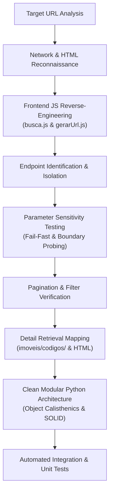

# Rental Search API Reverse-Engineering Plan & Execution Log

## 1. Executive Summary & Objective

The objective of this research is to completely reverse-engineer the rental search workflow of **Minas Caixa Imóveis** (`minascaixaimoveis.com.br`), focusing strictly on:
- The rental listing and search flow.
- Required supporting endpoints: filter discovery (cities, neighborhoods, property types, condominiums), pagination behavior, and property detail retrieval.
- Verifying whether authentication is needed (confirmed: entirely public, no authentication or session cookies required).

The end goal is to define and implement reusable Python modules following **SOLID**, **Clean Code**, **Object Calisthenics**, and **Design Patterns** (prioritizing: 1. correctness, 2. modularity, 3. style principles) serving as the core boundary interface for a central Rental Research Model Context Protocol (MCP).

Target Research URL:
```text
https://www.minascaixaimoveis.com.br/aluguel/imoveis/timoteo/todos-os-bairros/0-quartos/0-suite-ou-mais/0-vaga/0-banheiro-ou-mais/todos-os-condominios?valorminimo=0&valormaximo=0&pagina=1
```

---

## 2. Reverse-Engineering Methodology



The investigation proceeded in nine structured phases:

1. **Reconnaissance & Rendering Architecture**:
   - Inspected response headers, server stack (Apache + PHP backend), and HTML DOM.
   - Identified that `.corpo-imoveis` is sent empty from the server; all listings are fetched asynchronously via client-side AJAX requests.

2. **JavaScript Decompilation & Logic Extraction**:
   - Analyzed `assets/js/base_url/base_url.js`, `assets/js/busca/gerarUrl.js`, `assets/js/busca/busca.js`, and `assets/js/detalhe-imovel/detalhe-imovel.js`.
   - Mapped semantic URL segment parsing (`finalidade`, `tipo`, `cidade`, `bairro`, `quartos`, `suites`, `vagas`, `banheiros`, `condominio`, `valorminimo`, `valormaximo`, `pagina`).

3. **Endpoint Discovery**:
   - Isolated six direct endpoints:
     - `POST /cidadeAjax`: Available cities.
     - `POST /bairroAjax`: Neighborhoods by city.
     - `POST /tipoAjax`: Property types filtered by transaction purpose.
     - `POST /condominios`: Condominiums by transaction purpose.
     - `POST /imoveis/ajax/`: Core search and listing execution.
     - `POST /imoveis/codigos/`: High-resolution property detail retrieval (219 attributes).
     - `POST /imoveis/relacionadosAjax/`: Related properties recommendations.

4. **Payload Parameter Sensitivity & Boundary Probing**:
   - Systematically tested omitted parameters against `POST /imoveis/ajax/`.
   - Uncovered that the upstream PHP engine (`Api.php` line 128) throws HTTP 500 when mandatory fields are omitted.
   - Isolated the **strictly mandatory** fields:
     - `imovel[finalidade]`
     - `imovel[valorde]`
     - `imovel[valorate]`
     - `imovel[pagina]`
     - `imovel[codigocondominio]`
   - Confirmed optional filters: `codigocidade`, `codigoTipo`, `codigosbairros`, `numeroquartos`, `numerovagas`, `numerosuite`, `numerobanhos`, `ordenacao`.

5. **Pagination & Slicing Analysis**:
   - Confirmed fixed page size of 20 items per page.
   - Validated page 1: returns items 1 to 20 (`quantidade = 29`).
   - Validated page 2: returns items 21 to 29 (`quantidade = 29`, list length = 9).
   - Validated page 3: returns empty array (`quantidade = 29`, list length = 0).
   - Total pages calculation: `ceil(quantidade / 20)`.

6. **Filter Mechanics Validation**:
   - Verified array-indexed encoding for multi-selection filters:
     - `imovel[codigoTipo][codigo][]` and `imovel[codigoTipo][nome][]`
     - `imovel[codigosbairros][codigo][]` and `imovel[codigosbairros][nome][]`
   - Verified numerical thresholds for bedrooms, parking, suites, and bathrooms.
   - Verified sorting: `'valordesc'` (highest to lowest) vs `'valorasc'` (lowest to highest).

7. **Property Detail Investigation**:
   - Tested `POST /imoveis/codigos/` with `codigo=<id>`.
   - Verified batch capability: sending comma-separated codes (`codigo=6161,7989`) returns full objects for all requested properties in a single round-trip.
   - Documented the full 219-attribute schema (financial breakdown, geolocation, room dimensions, full media galleries, broker details).
   - Validated web fallback URLs: `GET /imovel/{slug}/{codigo}` and `GET /detalhe-imovel/{codigo}`.

8. **Auth & Session Requirements**:
   - Explicitly verified that no authentication tokens, API keys, or cookies are needed.
   - Standard HTTP POST requests without cookies or custom headers succeed immediately.

9. **Modular Architecture & Test Matrix**:
   - Designed clean domain boundaries complying with Object Calisthenics:
     - Primitive wrapping (`PropertyCode`, `RentalPrice`, `CitySlug`, `PageNumber`, etc.).
     - Classes with at most 2 instance variables.
     - Maximum 15 lines per function, 100 lines per class, 200 lines per module.
     - Guard clauses with early returns, zero `else` statements.
     - One dot per line.
   - Authored unit and live integration tests.

---

## 3. Empirical Test Matrix & Verification Log

| Test Case ID | Target Tested | Input Payload / Action | Expected Result | Observed Result | Status |
|---|---|---|---|---|---|
| TC-01 | City list | `POST /cidadeAjax` | JSON array of 26 cities | Status 200, 26 cities parsed | PASS |
| TC-02 | Neighborhood list | `POST /bairroAjax` with `cidade=timoteo` | JSON array of neighborhoods | Status 200, 43 Timóteo bairros | PASS |
| TC-03 | Type list | `POST /tipoAjax` with `finalidade=aluguel` | JSON array of 15 property types | Status 200, 15 types parsed | PASS |
| TC-04 | Rental search baseline | `POST /imoveis/ajax/` (Timóteo, all bairros, page 1) | JSON with total count 29, 20 items | Status 200, 20 items, max price R$ 20.000 | PASS |
| TC-05 | Pagination page 2 | `POST /imoveis/ajax/` with `pagina=2` | 9 remaining items | Status 200, 9 items returned | PASS |
| TC-06 | Pagination page 3 | `POST /imoveis/ajax/` with `pagina=3` | Empty items list | Status 200, 0 items returned | PASS |
| TC-07 | Mandatory field failure | `POST /imoveis/ajax/` omitting `codigocondominio` | Server failure or Api.php error | Error 500 in Api.php line 128 | PASS (Identified) |
| TC-08 | Property detail retrieval | `POST /imoveis/codigos/` with `codigo=6161` | JSON with 219 property attributes | Status 200, complete object returned | PASS |
| TC-09 | Batch detail retrieval | `POST /imoveis/codigos/` with `codigo=6161,7989` | Array of 2 full property objects | Status 200, both returned | PASS |
| TC-10 | Filter by bedrooms | `POST /imoveis/ajax/` with `numeroquartos=3-quartos` | 4 properties returned | Status 200, exactly 4 matched | PASS |
| TC-11 | Sort order | `POST /imoveis/ajax/` with `ordenacao=valorasc` | Lowest price first (R$ 500,00) | Status 200, ordered correctly | PASS |

---

## 4. Central Rental Research MCP Boundary Interface

The reverse-engineered components are encapsulated into a high-cohesion module structure suitable for direct import into an MCP server or client tool:

- **Domain Layer** (`minascaixa.domain`):
  - `primitives.py`: Value objects validating domain constraints (`PropertyCode`, `RentalPrice`, `PageNumber`, `CitySlug`, `TransactionPurpose`, `SortOrder`).
  - `models.py`: Composite entities (`PropertySummary`, `PropertyDetail`, `SearchCriteria`).
  - `collections.py`: First-class collections (`PropertyList`, `CityList`, `NeighborhoodList`, `PropertyTypeList`).
  - `exceptions.py`: Explicit domain exception hierarchy.
- **Infrastructure Layer** (`minascaixa.infrastructure`):
  - `http_transport.py`: Robust HTTP communication client with timeouts and status checks.
  - `endpoints.py`: Centralized URLs and parameter mapping constants.
  - `payload_builder.py`: Translates high-level domain criteria into wire-format form payloads.
  - `deserializer.py`: Transforms raw JSON responses into rich domain models.
- **Application Layer** (`minascaixa.application`):
  - `interfaces.py`: Clean abstract contracts (`RentalSearchPort`, `PropertyDetailPort`).
  - `service.py`: `RentalResearchService`, the primary facade implementing the MCP boundary.
  - `url_parser.py`: Reverse-engineers frontend search URLs directly into typed `SearchCriteria`.
